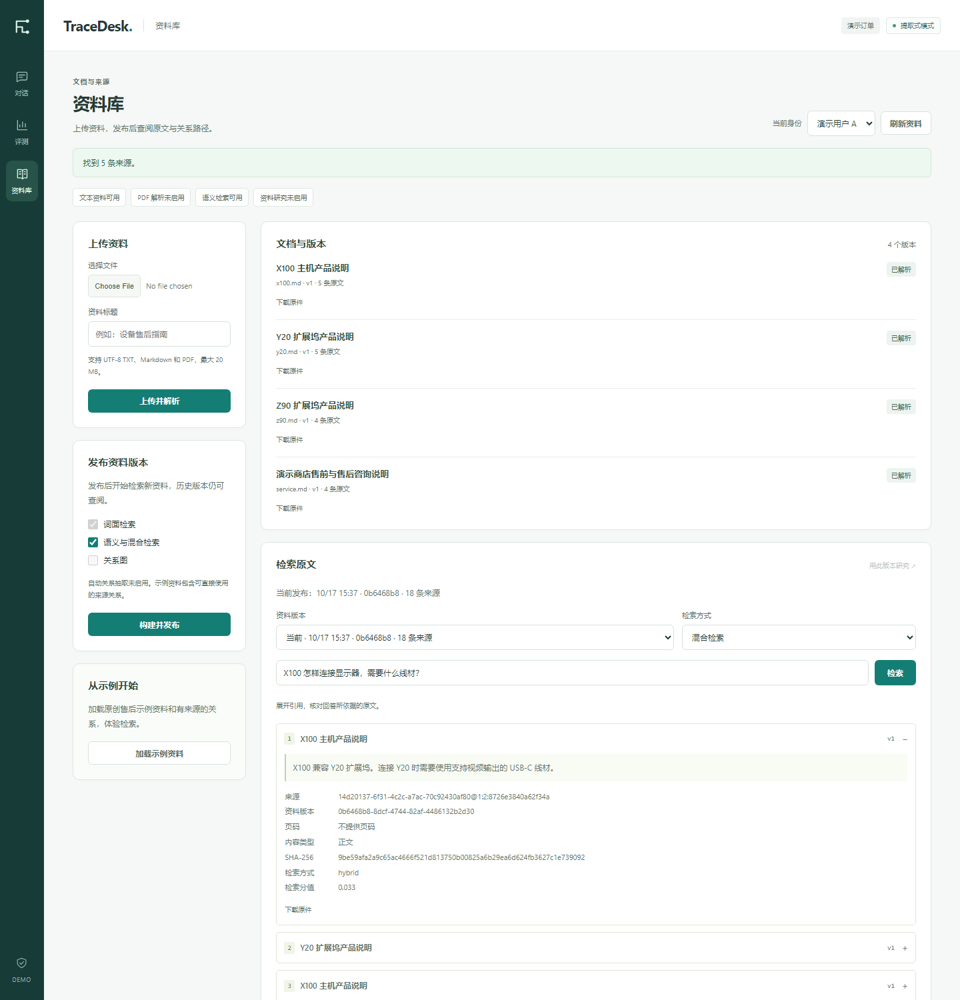

# TraceDesk

[](https://github.com/Hokkaidoooo/tracedesk/actions/workflows/ci.yml)

带版本化资料库、证据检索和确认流程的 AI 客服。可以上传资料、核对原文，使用单角色或多角色研究回答问题，也可以查询订单并在用户确认后创建演示退款申请。



[售后工作台](assets/workspace.png) · [申请回执](assets/refund-receipt.png) · [关系路径](assets/knowledge-graph.png) · [手机资料库](assets/knowledge-mobile.png) · [评测页面](assets/evaluation.png)

## 可以做什么

| 功能 | 使用条件 |
| --- | --- |
| TXT / Markdown 上传、版本记录、原件下载、词面检索 | 默认可用 |
| 原创示例资料与本地关系路径检索 | 默认可用，含 4 份文档和 6 条有原文依据的人工关系 |
| 语义检索与 RRF 混合检索 | 显式配置本地 ONNX BGE 或兼容嵌入服务 |
| PDF 文本与表格解析 | 显式配置 MinerU HTTP 或官方 CLI |
| LangGraph 协作研究、单研究者基线与公共核验角色 | 安装研究依赖并配置真实聊天模型 |
| Neo4j 图投影与受限 Text2Cypher | 配置 Neo4j；Text2Cypher 另需聊天与嵌入模型 |
| Microsoft GraphRAG Local / Global Search | 可选安装官方 2.7.0 并配置其模型与索引 |

模型接口由使用者配置。离线示例中的关系是人工给定并经来源检查的关系；本地图检索与 Microsoft GraphRAG 是分别实现的能力。未配置模型时，可以完整使用资料上传、词面检索、本地图示例和提取式售后流程。

## 运行

推荐 Python 3.10 或 3.12；从源码构建界面需要 Node.js 22.12+。

```powershell
python -m venv .venv
.\.venv\Scripts\Activate.ps1
python -m pip install -e '.[dev,research,graph,semantic]' -c requirements.lock
Set-Location .\web
npm ci
npm run build
Set-Location ..
tracedesk serve
```

打开 `http://127.0.0.1:8765`：

1. 进入“资料库”，点击“加载示例资料”，或上传自己的 UTF-8 TXT / Markdown。
2. 发布资料版本，选择词面检索或已启用的方法，展开原文、页码、SHA-256 和关系路径。
3. 配置模型后，在对话区选择“资料研究”。“协作研究”和“单角色研究”都会核验证据。
4. 选择“售后办理”，尝试“查询订单 TD-1001”或“申请退货 TD-1001”，核对申请卡片后再确认。

随包订单与示例资料均为自建演示内容。当前入口使用演示身份；退款申请只写入本地 SQLite，不连接实际支付或商家系统。

## 证据与状态

每条文档证据绑定商店、已发布快照、原文版本和原件 SHA-256。解析失败保留原件与错误，可显式重试；索引构建失败保留旧发布版本。历史检索固定快照，不会在查询途中切换资料。

研究模式通过模型规划、取证、撰写和核验形成结论。`single` 使用单个 researcher 加公共 verifier，`multi` 使用分工角色与有依赖的并行取证。模型、取证、上下文和并发共用预算，失败不会静默切换模式。

正式退款政策与上传资料相互独立。身份、金额、退款资格和回执由服务端规则与事务确定，研究回答不能办理或确认退款。

## 验证入口

```powershell
pytest -q
ruff check src tests
tracedesk evaluate --output reports\policy-evaluation.json
tracedesk knowledge load-demo --database .tracedesk\knowledge-evaluation.db
tracedesk evaluate-knowledge --database .tracedesk\knowledge-evaluation.db --output reports\knowledge-local.json
```

政策回归、资料检索消融、协议测试和真实模型评测分别记录。引用检查能核对来源与摘录；答案质量仍需在指定模型、固定资料快照和相同预算下评估。查看[v0.2 验证范围](docs/validation-v0.2.md)、[政策评测](docs/evaluation.md)与[资料检索评测](docs/knowledge-cli.md#检索消融评测)。

## 文档

- [安装、MinerU、嵌入模型与配置](docs/deployment.md)
- [架构与模型边界](docs/architecture.md)
- [HTTP 接口](docs/api-contract.md) · [知识与研究 CLI](docs/knowledge-cli.md)
- [图检索、Neo4j 与 Microsoft GraphRAG](docs/graph-retrieval.md)
- [多角色研究与单研究者基线](docs/research-workflow.md)
- [政策检索](docs/retrieval.md) · [确认与事务](docs/transactions.md)
- [界面与交互](docs/ui.md)

## 许可

TraceDesk 源码与原创示例资料采用 MIT 许可。依赖、可选模型和外部解析服务遵循各自的许可，见[第三方说明](THIRD_PARTY_NOTICES.md)与[来源记录](docs/provenance.md)。
