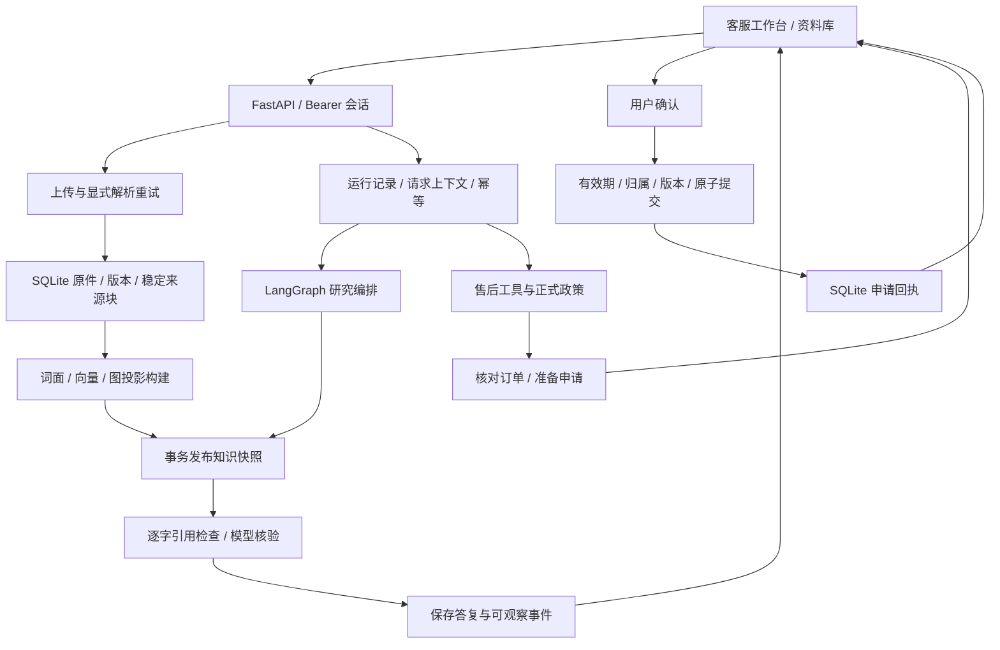

# 架构与不变量

TraceDesk 将文档知识、模型研究和售后事务分别管理。上传资料用于回答知识问题；正式退款政策、客户身份、订单金额与申请资格仍由既有规则和 SQLite 事务确定。

## 文档真源与发布

SQLite 保存原件、文档版本、解析结果、来源块、快照成员和当前发布指针。向量、本地图、Neo4j 与 Microsoft GraphRAG 文件都是可重建的快照投影。

同一商店内，相同原件 SHA-256 的上传幂等；同标题的新原件递增版本。解析状态为 `parsing → ready / failed`。失败重试保留原件与版本，分配新的 `parse_id`；旧尝试的迟到成功或错误不能覆盖新尝试。解析结果日志不可改写，已经成功解析的原文与块保持不变。

来源块的标识由文档、版本、块序号和内容摘要确定，不随索引重建改变。`Evidence` 统一记录 `source_id`、`tenant_id`、`snapshot_id`、文档与版本、正文、原件 SHA-256、页码、内容类型、检索分值和路径。TXT、Markdown 以及只有 Markdown 输出的 MinerU CLI 不提供页码；HTTP 解析只使用服务明确返回的页号。

构建选择每份文档的最新版本。最新版本尚未解析成功时明确拒绝构建，不使用旧版本代替。快照先进入 `building`，嵌入与附加索引在数据库写事务之外执行；全部成功后，在最后一个事务中保存投影并切换发布指针。超时、取消或构建失败进入 `failed`，原发布指针保持不变。

读取原件、来源和任意历史快照都经过 `Store.require_session` 与商店过滤。公开检索只接受已发布快照，所有方法使用同一个固定来源集合。

## 检索方式

| 范围 / 方法 | 实现 |
| --- | --- |
| 正式政策 | 原有 BM25、字符 n-gram 与 RRF；先按商店、生效日期筛选 |
| 资料库 `lexical` | 共享中文双字与拉丁词分词，使用词频余弦排序 |
| 资料库 `semantic` | 本地 ONNX BGE 或兼容 HTTP 嵌入，归一化后做精确余弦排序 |
| 资料库 `hybrid` | 对同一快照的词面、语义排名做 RRF 融合 |
| `graph` | 受跳数与展开预算限制的来源关系路径；按配置使用本地或 Neo4j |
| `text2cypher` | 模型生成受限查询，经语法与图结构验证后重新编译并交给 Neo4j |
| `graphrag_local / graphrag_global` | Microsoft GraphRAG 2.7.0 官方检索，映射回原文 Evidence |

本地 BGE 使用 `tokenizer.json`、ONNX `last_hidden_state[:, 0, :]` 的 CLS 池化与 L2 归一化。模型文件、tokenizer 与相关配置纳入指纹。输入超出 token 上限、返回维度不符、非有限向量、响应错序或模型身份不符均报错。

向量与模型指纹绑定快照。请求语义或混合检索时，当前模型必须匹配该指纹；没有向量、模型不匹配或投影不完整都不会改为词面检索。当前实现适合本地规模的精确向量排序。

图关系要求引用已知来源，且引用原文包含关系两端实体。人工关系与模型抽取关系有明确记录；实体出现检查只能证明出处，关系含义仍需核对。Neo4j 导入和查询保留商店、快照、来源与方向，模型不能指定这些作用域。

Text2Cypher 复用资料库的真实嵌入器，从 8 对自建合成问题与只读 Cypher 中语义召回最多 3 个提示示例。示例按当前模型指纹和维度缓存在服务实例内，只用于查询结构提示，不作为回答的知识事实。该路径要求嵌入、聊天模型和已发布 Neo4j 投影；缺少嵌入不会退回零样本或词面示例。

Text2Cypher 使用允许语法解析器和参数化模板，模型原始 Cypher 不直接执行。Microsoft GraphRAG 另有官方索引和来源表契约，本地图不称为 Microsoft GraphRAG。详见[图检索说明](graph-retrieval.md)。

## 研究编排

`multi` 使用 LangGraph 的 `plan → execute → draft → verify` 状态图。planner 生成有依赖的任务；retriever 通过独立模型调用选择查询，符合依赖关系的任务有限并行；writer 生成逐条结论与引用；verifier 核验每条结论。

`single` 是单个 researcher 加同一 verifier 的基线：固定一个任务，连续完成查询选择与撰写，再进行公共核验。它不等于一次模型调用。两种模式使用相同的模型接口、检索回调、固定快照与最终来源校验。

聊天模型请求总数、取证次数、累计上下文字符数、并发槽位和总时限由本轮共享预算控制，嵌套 Text2Cypher 聊天调用也使用同一受限 provider。嵌入使用独立的批量、超时设置，并受取证次数与研究总时限约束。超预算时失败，不裁剪证据后继续宣称完整核验。

Microsoft GraphRAG SDK 的内部调用尚未纳入该预算，因此 Local / Global Search 通过独立检索入口使用，不能加入研究方法白名单。

最终答复只保留 verifier 支持的结论；返回 `answered`、`partially_supported` 或 `insufficient_evidence`。确定性检查保证引用 ID 存在、摘录为原文连续片段、元数据来自已绑定来源；模型核验仍可能出错。完整流程见[研究说明](research-workflow.md)。

## 售后工具与确认

售后模型允许调用 `search_knowledge`、`lookup_order`、`prepare_refund` 和 `final_answer`。工具注册表同时生成 JSON Schema 与参数校验，客户身份和订单金额不接受模型替换。

正式政策的文字与执行规则来自同一份 `rules`。`final_answer` 选择状态与来源，不接受自由的成功声明；售后答复由完整政策段落、已核验订单字段和动作状态组成。研究角色没有退款确认或业务写入工具。

每个运行最多准备一个动作。动作准备后，本轮订单上下文锁定；确认时重新检查所属会话、有效期、政策、订单版本及幂等请求。确认必须来自用户，成功只以实际事务回执为准。详见[事务说明](transactions.md)。

## 会话与请求一致性

运行以 `(session_id, request_id)` 去重。`runs.request_context` 为研究请求保存已解析的 `research_mode` 与 `snapshot_id`，售后请求使用空上下文。相同请求 ID 改变消息、模式或快照会冲突；聊天 provider 配置变化不改写已经保存的合法回放结果。

研究的 `runtime` 记录为 `research:<mode>:<snapshot_id>`，是运行说明；请求上下文才是幂等比较的依据。浏览器重试保存首次选定的模式与快照，不能把“当前版本”重新解析成另一份资料。

同一会话只允许一个活动请求，租约过期保留中断状态。历史 turn 不可变；读取历史或重放时叠加申请的当前状态，已提交或取消的申请不再返回确认凭证。研究错误、取消与预算耗尽保留真实运行记录，不产生替代成功答案。

## 数据与部署边界

演示身份选择器用于自建数据，不能作为真实客户登录系统。SQLite WAL 支持单机持久化与有限写并发；真实业务部署还需身份适配、数据库备份与外部业务事务。

配置远程解析、嵌入或聊天服务后，相应资料会发往所选服务。模型与来源正文属于不可信输入，不获得额外工具权限。来源检查和模型 verifier 都不能证明原件真实、知识完整或所有结论正确。

## 代码入口

| 模块 | 职责 |
| --- | --- |
| `bootstrap.py / settings.py` | 依赖装配与显式配置 |
| `knowledge/ / evidence.py` | 原件、解析、嵌入、快照、统一 Evidence |
| `graphs/` | 来源图、Neo4j、受限 Text2Cypher、官方 GraphRAG 适配 |
| `research/` | LangGraph、依赖执行、共享预算、撰写与核验 |
| `knowledge_workflows.py` | 绑定商店、快照、检索能力与研究上下文 |
| `agent.py / tools.py / retrieval.py` | 既有售后运行、工具与正式政策 |
| `store.py / refunds.py` | 会话、运行、数据库迁移与确认事务 |
| `api.py / knowledge_api.py / cli.py` | 调用同一服务的 HTTP 与命令行入口 |
