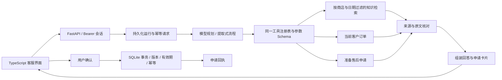

# 架构与不变量

TraceDesk 把模型限定为工具选择器和证据选择器。政策、客户身份、金额、申请资格和执行结果分别由明确的数据与服务负责，最终回答由完整来源段落和可核对的业务字段组装。

## 模型与确定性代码的边界

| 任务 | 责任方 | 原因 |
| --- | --- | --- |
| 改写检索表达、选择工具、组合相关来源 | function-calling 模型 | 自然语言表达和多轮意图具有变化性 |
| 客户身份和订单归属 | Store + 会话 | 不能接受模型或客户端替换客户 |
| 生效中的退货天数、商品类别、状态限制 | 版本化知识中的 `rules` | 政策文字和执行规则使用同一真源 |
| 申请金额、订单版本 | 数据库订单 | 模型工具不接受金额参数 |
| 引用检查与答复文字 | ToolExecutor | 展示完整来源，避免删掉限制条件；不接受自由的成功声明 |
| 确认和提交 | RefundService + SQLite | 模型没有确认工具，提交必须经过用户请求 |

模型允许调用 `search_knowledge`、`lookup_order`、`prepare_refund` 和 `final_answer`。注册表同时生成 JSON Schema 和执行校验。它没有 SQL、Shell、文件写入、任意 HTTP 或直接退款工具。

`final_answer` 只接受状态、来源与需要补充的信息类型，不接受自由 `answer` 字段。回答保留所选知识的完整段落。这个选择牺牲了自由改写的语气和压缩能力，换取更容易核查的输出；它不能自动判断知识内容是否真实、是否过时或是否与问题充分相关。

## 两种运行方式

`extractive` 使用显式意图规则和检索摘录，适合不配置模型即可运行的演示和确定性回归。它不调用语言模型，不伪造思考、token 数或流式生成。

`llm` 调用兼容 chat-completions function calling 的服务。每轮限制模型步数、工具数、输出字符数和完成 token 数；HTTP 请求同时受空闲超时和总时限控制。连接异常、错误状态码、非法响应和超预算均显式失败，不降级为提取式回答。模型服务返回的私有推理字段不转发、不入库。

默认检索方法为 `ngram`：它在当前固定回归集的 MRR 高于 BM25 和 RRF。保留三种方法供消融，不能据小型合成集推出普遍优越性。通过 `TRACEDESK_RETRIEVAL_METHOD` 切换，不叠加一条静默后备检索路径。

## 多轮状态与事务

会话、运行、历史答复、待确认动作和回执均在一个 SQLite 存储层中管理。成功查询的订单 ID 用于明确指代的后续问题；每次读取都重新检查当前客户归属。同一会话一次只运行一个请求，超出租约的孤儿运行保留中断记录。

每个运行最多准备一个动作，数据库有唯一约束。同参工具重试复用本轮动作；改变订单或原因必须新开一轮。动作准备后，本轮订单上下文锁定，避免回答、金额与卡片对应不同订单。

租约到期后，存储层记录的中断状态是最终依据。编排层保留该错误和运行 ID，首次响应与网络重放返回相同的中断原因，不用二次“运行不活跃”错误覆盖它。

历史 turn 是不可变快照。HTTP 的历史读取与请求重放都会叠加动作当前状态；已提交或取消的动作不再向页面提供确认 token。失败会取消本轮尚未交付的待确认动作，并保留失败事件。

## 已知边界

- 演示身份选择器不是生产身份认证。当前只允许演示数据，不能直接接入真实客户信息。
- SQLite WAL 适合单机演示和有限写并发，不能替代多实例数据库、分布式队列或真实支付事务。
- 检索不使用稠密嵌入模型；难同义表达仍有漏召回。引入向量检索或 reranker 前应保持相同用例和消融条件。
- 来源检查不是语义蕴含证明。知识需人工治理；用户与知识中的提示注入不能获得额外工具权限，但不承诺消除所有错误的证据选择。
- 申请仅写入本地演示账本。没有支付回调、商家工单、物流实时查询或生产监控集成。

## 代码入口

`bootstrap.py` 负责组装依赖；`agent.py` 控制运行和预算；`tools.py` 统一工具与回答组装；`retrieval.py` 管理版本化知识；`store.py` 和 `refunds.py` 管理状态与事务；`api.py` 暴露同一组服务；`evaluation.py` 直接调用这些服务，避免另写一套用于展示的业务流程。
