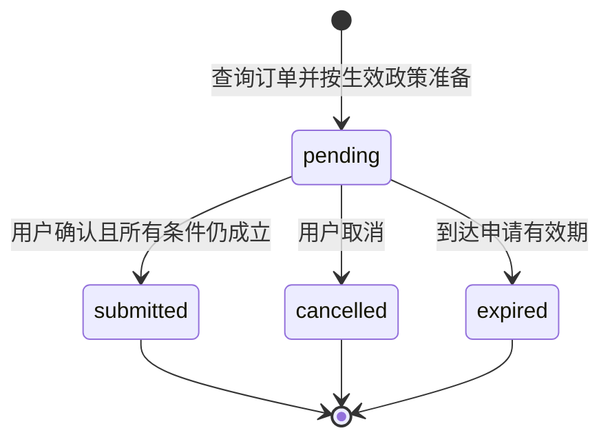

# 售后事务与失败恢复

TraceDesk 将客户、会话、运行、对话快照、售后申请和回执保存在同一个 SQLite 数据库。模型可以查询订单并准备申请；提交接口由用户确认触发，金额与订单归属始终从数据库读取。

`submitted` 表示内部退款申请已成功落库，不表示支付渠道已退款。当前版本没有连接真实商户、支付机构或仓储系统。

## 从建议到可核验的申请



准备和确认调用同一个资格判定函数。时间窗口、允许的订单状态和排除的商品分类来自知识库文档 `returns` 的结构化 `rules`，代码没有独立的“七天退货”常量。政策按会话所属商户和当前 UTC 日期选择。

资格判定要求签收时间存在且不在未来，并满足 `当前时刻 − 签收时刻 ≤ window_days × 86400 秒`。恰好处于窗口终点仍符合条件；窗口刚过去或分类不适用会返回明确原因。

准备申请保存订单版本、政策来源版本、金额、币种、原因和截止时间。确认时重新检查：

1. 当前会话与准备申请的会话相同，确认 token 匹配。
2. 申请仍是 `pending`，尚未达到截止时刻。
3. 订单版本、金额和币种均与准备时一致，且没有其他已提交退款申请。
4. 当前生效政策的 `source_id` 与准备时相同，订单仍满足政策。

没有生效政策、政策结构错误、政策更新、订单变化或超过期限都会显式失败。金额不是模型参数，也不能由确认请求覆盖。

每次运行至多准备一个申请，由 `actions.run_id` 唯一约束保证。直接重复调用准备接口会返回 `ACTION_ALREADY_PREPARED`，包括换订单或原因的调用。编排层可在同次运行中对相同参数的工具重试返回已持有的原申请；准备另一份申请需要新的运行。

## 一次提交的数据库边界

确认使用 `BEGIN IMMEDIATE`。同一事务内依次写入订单唯一的退款申请、按版本条件更新订单为 `refund_requested`、创建回执、将申请置为 `submitted`，最后保存确认请求的幂等结果。

数据库负责以下不变量：

| 不变量 | 约束 |
| --- | --- |
| 一次运行至多准备一个申请 | `actions.run_id` 唯一约束 |
| 一个订单至多提交一次退款申请 | `refund_requests.order_id` 主键 |
| 退款申请只能引用对应订单的准备动作 | 组合外键 |
| 一份回执只能对应实际提交的申请 | 回执外键、唯一订单和唯一申请约束 |
| 每次订单更新恰好推进一个版本 | 触发器与条件更新 |
| 准备时的金额、原因、政策版本和凭据摘要不可改写 | 申请快照触发器 |
| 已提交、已取消、已过期不能恢复为待确认 | 状态转换触发器 |
| 回执、已提交退款记录和历史对话不能被更新或删除 | 不可变记录触发器 |

连接统一开启外键检查和 5 秒 busy timeout；数据库使用 WAL。等待数据库锁超时会暴露 SQLite 错误，不会将其包装成提交成功。任意非业务异常都会让未完成事务回滚。测试在回执写入处注入 SQL 错误，核对订单、申请、退款记录和幂等记录均未发生部分提交。

## 网络重试与重复确认

幂等键按会话隔离。对话请求与确认请求分别使用各自的 `request_id` 空间。

| 情况 | 结果 |
| --- | --- |
| 同一对话请求 ID、同一消息，执行完成后重试 | 返回原始对话快照 |
| 同一对话请求 ID 换了消息 | `REQUEST_CONFLICT` |
| 同一请求仍在运行 | `RUN_IN_PROGRESS` |
| 会话中已有其他运行 | `SESSION_BUSY` |
| 重试已经失败或被中断的运行 | 返回原错误，不重新执行 |
| 同一确认请求 ID、同一申请和 token | 返回原回执或原业务错误 |
| 同一确认请求 ID 换了申请或 token | `REQUEST_CONFLICT` |
| 已提交申请使用新的确认请求 ID 重复确认 | 返回同一回执，`replayed: true` |
| 不同申请并发提交同一个订单 | 一个提交成功，其余返回 `ORDER_ALREADY_REQUESTED` |

确认失败也会保存原业务错误。例如先因政策变化而失败，同一请求 ID 的重试仍返回该错误。重新发起确认需要新的请求 ID，且原申请仍须通过全部现时校验。SQLite 写入失败和未预期的程序异常会回滚，不会生成幂等成功记录。

## 运行租约与会话上下文

每个会话至多有一个 `running` 运行，数据库中的部分唯一索引是最后一道约束。不同会话可以同时运行。

运行具有固定租约，默认 300 秒，通过 `run_lease_seconds` 配置。创建新运行、读取运行详情或保存运行结果时，会检查并持久化已过期的运行：状态设为 `interrupted`，记录 `INTERRUPTED` 错误及可见事件。租约到期后的旧执行不能再保存回答；使用新的请求 ID 可以继续。

该机制不会自动重试模型或重做工具调用，也不恢复进程退出前尚未保存的步骤。需要把租约设置得长于一次合法运行的最大预算。

每次成功查询订单后才更新该会话的 `last_order_id`。跨客户订单与不存在的订单均返回 `ORDER_NOT_FOUND`，不会用失败查询覆盖上下文；即使同一客户创建了多个会话，上下文和运行记录也分别隔离。

## 凭据和历史快照

会话 bearer token 使用密码学随机数生成，只在创建会话时返回，数据库仅保存 SHA-256 摘要。售后申请表也只保存确认 token 的摘要，比较摘要使用恒定时间比较。

**历史对话快照包含原始待确认申请及其确认 token。** 这是原样重放原响应所需的数据，不应宣称数据库中的所有凭据都只有摘要。数据库文件属于敏感运行状态，应限制文件访问、排除在源码仓库之外，并纳入实际部署的备份保护范围。运行 trace 不应包含 bearer token 或确认 token。

历史对话保持不变。查询当前申请状态使用 `current_action`，它不返回确认 token。前端应按当前状态显示按钮，不能把历史快照中的 `pending` 当成当前仍可提交的依据。

## 初始化与版本

首次初始化在事务中创建 schema 并写入演示客户和订单。以后重开数据库不会重新播种、重置相对日期或覆盖已经变化的订单。`user_version` 与当前 schema 不兼容时会显式报错；存在未识别表的数据库不会被自动接管。没有隐式降级、自动清库或猜测式迁移。

该版本使用本地文件数据库和按事务创建的连接，适合单机、多线程或同机多个进程访问。它没有实现跨主机写入、真实支付补偿、长期凭据轮换或后台批量过期清理；过期状态在访问时持久化。

## 验证入口

```powershell
python -m pytest tests\test_store.py tests\test_refunds.py -q
```

测试使用真实临时 SQLite 文件，覆盖重开恢复、跨客户与跨会话隔离、不可变快照、请求冲突、失败重放、租约边界、政策日期和分类、取消、过期、订单版本、重复与并发准备、SQL 故障回滚及并发确认。另有一条集成用例直接加载随包发布的知识与演示订单，完成准备到回执的完整业务事务。
